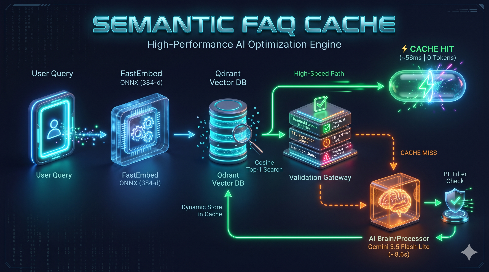

<div align="center">

# Semantic FAQ Cache

**Low-latency vector caching for Indian e-commerce support with bilingual negation guards and threshold calibration.**

[](https://python.org)
[](https://qdrant.tech)
[](https://github.com/qdrant/fastembed)
[](https://ai.google.dev)

</div>

---

## Overview

A semantic caching layer built from first principles in Python. Instead of sending every customer support query to an LLM, incoming queries are embedded locally on CPU and matched against **Qdrant** via cosine similarity—cutting repeat-query latency from **8,625 ms to 56.6 ms (~152x speedup)** with **zero token cost** while blocking false hits on opposite-intent (`not` / `nahi`) queries.

## Architecture



## Core Features

| Component | Implementation | Purpose |
| :--- | :--- | :--- |
| **Local Embeddings** | `FastEmbed` (`paraphrase-multilingual-MiniLM-L12-v2`) | 384-d ONNX CPU vectors without PyTorch/CUDA overhead |
| **Vector Store** | `Qdrant` (`:memory:` cosine index) | Sub-millisecond top-1 semantic retrieval |
| **Negation Guard** | English + Hinglish polarity check (`not`, `nahi`, `never`, `mat`) | Blocks opposite-intent queries scoring `>0.80` similarity |
| **Cache Hygiene** | TTL (`86400s`) + Regex PII filter (`ORD-\d+`, phone, email) | Prevents stale policies and cross-user PII leaks |

## Benchmark Results (100-Query Sweep)

Evaluated across **30 canonical FAQs** and **100 labelled queries** (60 paraphrases + 40 out-of-scope & negation traps):

| Threshold | Hit Rate | False Hits | Negation Catches | Avg Latency |
| :---: | :---: | :---: | :---: | :---: |
| `0.65` | 27.0% | 5 | 6 | 500.51 ms |
| `0.70` | 17.0% | 3 | 3 | 564.57 ms |
| `0.75` | 10.0% | 1 | 3 | 605.75 ms |
| **`0.80` (Selected)** | **5.0%** | **0** | **2** | **643.01 ms** |
| `0.85` | 3.0% | 0 | 1 | 657.45 ms |

### Key Takeaways

- **Zero-False-Hit Cutoff (`0.80`):** Lower cutoffs (`0.65`) conflated distinct sub-intents (e.g., *COD refund destination* vs. *refund timeline* at `0.769`). Setting `threshold = 0.80` eliminated all false hits.
- **Negation Guard Efficacy:** Opposite-intent queries routinely exceeded `0.80` similarity (*"why can I not download my GST invoice?"* = **`0.921`**, *"refund kyun nahi milega?"* = **`0.822`**) and were intercepted before serving cached responses.
- **Cross-Lingual Behavior:** Multilingual MiniLM aligns Devanagari Hindi with English, while Romanized Hinglish (`"toota hua product"`) scores `0.19–0.55` against English seeds—requiring dynamic cache-on-miss to capture Hinglish-to-Hinglish repeat traffic.

<details>
<summary><b>View Live CLI Demo Trace</b></summary>

```text
=== Semantic FAQ Cache Demo (type 'exit' to quit) ===

Ask a question: How many days does a refund take?
[CACHE MISS (empty_cache) | sim=0.0 | 8625.05 ms | 67 tokens | stored=True]
Answer: Namaste! Refunds typically take 5-7 business days to reflect in your original payment method after the returned item is inspected at our warehouse.

Ask a question: how many days for refund money to come in bank?
[CACHE HIT | sim=0.8947 | 56.63 ms | 0 tokens]
Matched: "How many days does a refund take?"
Answer: Namaste! Refunds typically take 5-7 business days to reflect in your original payment method after the returned item is inspected at our warehouse.

Ask a question: refund kyun nahi milega?
[CACHE MISS (below_threshold) | sim=0.7162 | 8633.14 ms | 87 tokens | stored=True]
Answer: Namaste! Refund mein thodi der lag sakti hai agar product quality check mein fail ho gaya ho ya return policy expire ho gayi ho.
```

</details>

## Project Structure

```text
semantic-faq-cache/
├── data/
│   ├── faqs.json
│   └── test_set.json
├── docs/
│   └── architecture.png
├── results/
│   ├── sweep_summary.csv
│   └── request_logs.jsonl
├── src/
│   ├── cache.py
│   ├── llm.py
│   ├── evaluate.py
│   └── demo.py
├── .env.example
├── .gitignore
├── pyproject.toml
├── uv.lock
└── README.md
```

## Quickstart

### 1. Clone the repository

```bash
git clone https://github.com/YOUR_USERNAME/semantic-faq-cache.git
cd semantic-faq-cache
```

### 2. Install dependencies

This project uses `uv` for dependency management.

```bash
uv sync
```

### 3. Configure environment variables

Create a `.env` file in the project root and add your Gemini API key:

```bash
echo "GEMINI_API_KEY=your_api_key_here" > .env
```

Replace `your_api_key_here` with your actual Gemini API key.

### 4. Run the benchmark

```bash
uv run python -m src.evaluate
```

Runs the 100-query threshold sweep and evaluates cache performance across different similarity thresholds.

### 5. Launch the interactive CLI demo

```bash
uv run python -m src.demo
```

Starts the interactive semantic FAQ cache. Ask customer support questions and observe cache hits, cache misses, similarity scores, response latency, and token usage.

## Tech Stack

- **Language:** Python 3.12
- **Vector Database:** Qdrant
- **Embedding Model:** FastEmbed – paraphrase-multilingual-MiniLM-L12-v2
- **Inference:** ONNX Runtime (CPU)
- **LLM Fallback:** Gemini Flash-Lite
- **Dependency Management:** uv

## Security

- API keys are stored in environment variables rather than hardcoded.
- PII filtering prevents order IDs, phone numbers, and email addresses from entering the cache.
- TTL-based expiration prevents outdated cached responses from being served indefinitely.
- `.env` should never be committed to version control.

---

<div align="center">

**Built with Python, Qdrant, FastEmbed and Gemini.**

</div>
